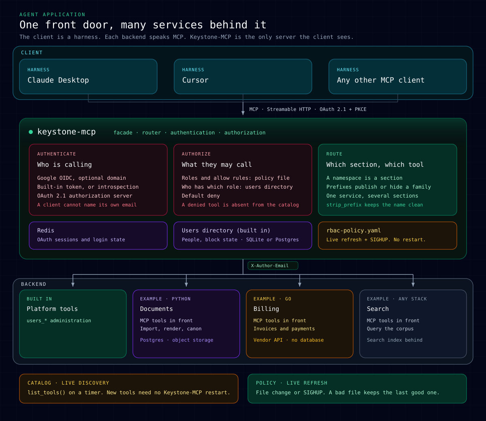

# Keystone-MCP

<p align="center">
  <a href="https://github.com/keystone-codes/keystone-mcp/actions/workflows/ci.yml"></a>
  &nbsp;&nbsp;&nbsp;&nbsp;
  <a href="pyproject.toml"></a>
  &nbsp;&nbsp;&nbsp;&nbsp;
  <a href="CHANGELOG.md"></a>
  &nbsp;&nbsp;&nbsp;&nbsp;
  <a href="https://github.com/jlowin/fastmcp"></a>
  &nbsp;&nbsp;&nbsp;&nbsp;
  <a href="https://modelcontextprotocol.io"></a>
  &nbsp;&nbsp;&nbsp;&nbsp;
  <a href="skills/keystone-user-admin/SKILL.md"></a>
</p>

Keystone-MCP is the single front door of an agent application. A person
works in one MCP client — Claude Desktop, Cursor, Claude Code — and that
client talks only to Keystone-MCP. Behind it you run your own services,
each in its own language, with its own storage, exposing its work as MCP
tools.

Keystone-MCP is one layer with three jobs: **facade** (one address and one
tool catalog for the client, split into sections), **router** (every call
is forwarded to the service that actually owns that tool), and
**authorization** (it checks who signed in and decides, from one policy
file, what that person may see and call). Services keep their business
logic and do not check roles themselves — Keystone-MCP already decided
before the call reaches them.



Documents, Billing and Search on the diagram are examples of services you
bring. Keystone-MCP ships the facade, the built-in users directory, and
the proxy.

## Try it locally

Three containers — Keystone-MCP, Redis, and a sample upstream service — up
in one command, with a sign-in, a second person with a smaller role, and
that person's catalog shrinking to match:

```bash
git clone https://github.com/keystone-codes/keystone-mcp.git
cd keystone-mcp
docker compose -f docker-compose.demo.yml up -d --build --wait
```

Then connect a client and sign in:
[docs/paths/local-compose.md](docs/paths/local-compose.md) (about 15 minutes).

> **DEV tokens are for your machine only.** They are a shared password —
> anyone holding one signs in as any email already in the users directory.
> The `production` profile refuses to start with one set. See the
> [security model](docs/security-model.md).

## Get started

- **Local** — [Run Keystone-MCP on your machine](docs/paths/local-compose.md)
- **Production** — [Deploy with Docker, Postgres and TLS](docs/paths/production-docker.md)
- **PyPI** — `pip install keystone-mcp-gateway`, then `keystone-mcp serve` ([docs/deploy.md](docs/deploy.md#from-pypi); the package name differs from the command and the image — `keystone-mcp` on PyPI is an unrelated project)

## Why Keystone-MCP

- **One facade.** A client sees one address and one tool catalog, split into
  sections, one per service.
- **Any users directory.** Built in (SQLite for one host, Postgres for
  production), or your own directory over HTTP.
- **Any sign-in method.** Google, DEV tokens for local testing, and a
  deprecated API-key method — all three behind one `LoginProvider` interface.
- **Onboarding and access through the agent.** An administrator adds people,
  changes roles, and manages access by asking the agent — [two agent
  skills](docs/README.md#i-manage-who-has-access) (`users_*` and `policy_*`
  tools), or `setup.sh --non-interactive`.
- **Services in any language or SDK.** Each one is a plain MCP server
  behind a transparent proxy; it keeps its own stack and storage.
- **One policy file, reloaded live.** Access rules live in a single file;
  a change takes effect on `SIGHUP`, no restart.
- **Services never check roles themselves.** RBAC is decided once, on
  Keystone-MCP, before a call is forwarded.
- **`production` refuses a weak setup.** DEV tokens, a SQLite users
  directory, and plain HTTP on a public host fail startup, not just a warning.
- **Metrics and audit included.** Prometheus series and structured
  authorization events ship with the process.
- **One image, two architectures.** `linux/amd64` and `linux/arm64`.

Full description of every capability, and what is still ahead:
[docs/features.md](docs/features.md).

## What it does not do

- **One organization per deployment.** One users directory, one policy file
  and one upstream registry per Keystone-MCP. For several organizations,
  run several instances. Multi-tenancy is not planned.
- **No admin UI.** People and roles are managed with the `users_*` tools from
  an agent, the `keystone-mcp users` commands and the policy file. A UI
  could be a separate project on top of the users directory protocol.
- **No business data.** Keystone-MCP stores people, roles and sessions; your
  services keep their own data and logic.
- **No routing by request content.** A call goes to the service that owns the
  tool name; arguments are not inspected or rewritten.
- **Not a sandbox for upstream code.** A stdio upstream runs as the same OS
  user as Keystone-MCP with no isolation; trust it like you trust Keystone.

## Documentation

All guides, grouped by role: [docs/README.md](docs/README.md).

Metrics and structured logs: [audit and metrics](docs/observability-rbac.md),
[logging](docs/observability-logging.md).

## Contributing

See [docs/CONTRIBUTING.md](docs/CONTRIBUTING.md).

## Security reports

See [SECURITY.md](SECURITY.md).

## License

Keystone-MCP is released under the [Apache License 2.0](LICENSE).
Copyright 2026 Alexey Klochkov (skynet@kofe.in).

You may use, modify and distribute it, including commercially. Keep this
license and the copyright notice with the code, and mark the files you change.

<p align="center">
  <a href="LICENSE"></a>
</p>
