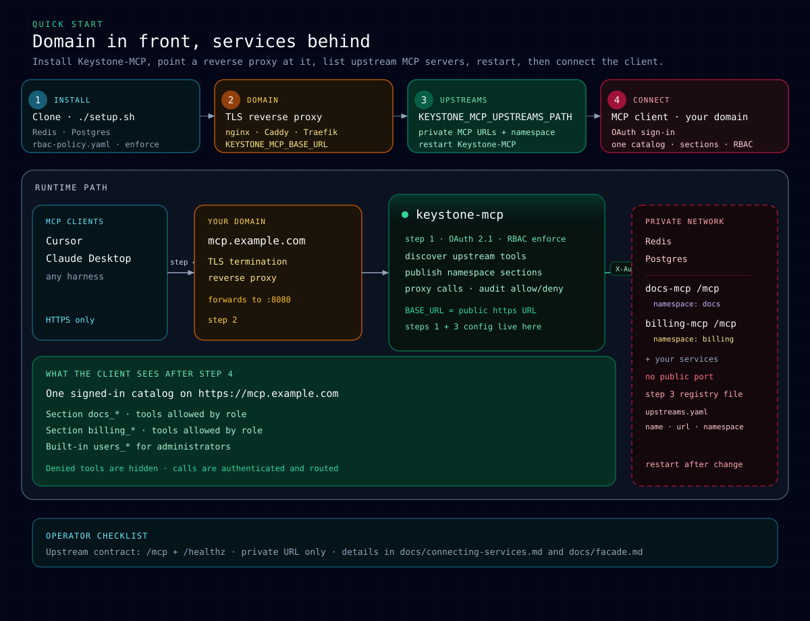

# Quick start

From zero to one authenticated catalog with tools grouped by namespace sections.
The [README](../README.md) covers trying Keystone-MCP locally in one command;
this page is the step-by-step detail for wiring a deployment from scratch.



## Steps

| Step | What you do | Result |
|------|-------------|--------|
| **1. Run Keystone-MCP** | Clone the repo, run [`../setup.sh`](../setup.sh) (or your container). Choose a profile (`local` or `production`); it writes `.env` with Redis, the [users directory](users.md), and the role policy ([`../config/rbac-policy.yaml`](../config/rbac-policy.yaml)) already in `KEYSTONE_MCP_RBAC_MODE=enforce`. | Keystone-MCP listens locally; OAuth and sessions use Redis. |
| **2. Publish on a domain** | Put a reverse proxy in front of Keystone-MCP: TLS on `https://mcp.example.com`, forward to `KEYSTONE_MCP_HOST`:`KEYSTONE_MCP_PORT`. Set `KEYSTONE_MCP_BASE_URL` to that public URL (OAuth metadata and Google redirect URIs depend on it). | Clients reach only the proxy URL, not upstream ports. |
| **3. Add a sign-in provider** | Create an OAuth client at Google ([google-oauth.md](google-oauth.md)) or your OIDC provider with the redirect URI `{KEYSTONE_MCP_BASE_URL}/login/<name>/callback`, and list it in `login-providers.yaml` ([login-providers.md](login-providers.md)). | People can sign in once the provider answers. `/healthz` and `/readyz` do not check this; only a real sign-in does ([production checklist](production-checklist.md)). |
| **4. Wire MCP services** | Run each backend on a network Keystone-MCP can reach (not on the public internet). List them in a registry file (`KEYSTONE_MCP_UPSTREAMS_PATH`) — one entry per service with `url`, `namespace` (section name), and optional prefix filters. A service that is down does not block startup; its tools appear once it answers. | Keystone-MCP discovers tools and publishes them as `namespace_toolname` sections. |
| **5. Sign in from the client** | Add Keystone-MCP in the MCP client using your domain and complete the browser sign-in through the provider from step 3. Machines use API keys instead ([clients.md](clients.md)). | Each person sees one catalog: built-in tools plus allowed upstream sections, filtered by role. Calls are authenticated and routed; upstreams receive a signed `X-Keystone-Identity` ([connecting-services.md](connecting-services.md)). |

## Upstreams example

Minimal registry (private URLs only):

```yaml
schema_version: 1
entries:
  - name: docs
    url: http://docs-mcp:8081/mcp
    namespace: docs
    enabled: true
  - name: billing
    url: http://billing-mcp:8082/mcp
    namespace: billing
    enabled: true
```

Plain `http` is fine on an internal Docker or Kubernetes network that is not
reachable from the internet. Set `KEYSTONE_MCP_UPSTREAM_ALLOW_INSECURE_HTTP=true`;
the production profile logs one warning at startup.

Save the file, point `KEYSTONE_MCP_UPSTREAMS_PATH` at it, and validate before
restarting Keystone-MCP:

```bash
keystone-mcp upstream validate --path /path/to/upstreams.yaml
```

## Next

- Try it locally first: [paths/local-compose.md](paths/local-compose.md)
- Deploy with Docker (the main production path): [paths/production-docker.md](paths/production-docker.md)
- Kubernetes example: [paths/kubernetes.md](paths/kubernetes.md)
- Service contract: [connecting-services.md](connecting-services.md)
- Mounting and filters: [facade.md](facade.md)
- Host install and systemd, without a container: [deploy.md](deploy.md)
- Every `KEYSTONE_MCP_*` variable: [environment.md](environment.md)
- Production hardening: [production-checklist.md](production-checklist.md)
