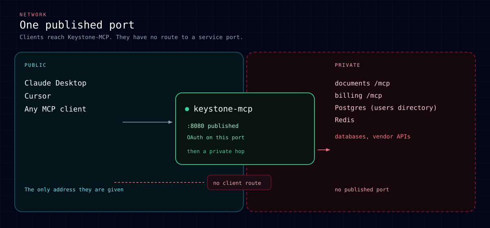

# Security model

Keystone-MCP is the only public entry point of the application behind it.
Access is not one setting but three independent ones — who exists, how they
prove who they are, and what they may call — plus a profile switch that
decides which of them the server lets you get wrong. This page explains each,
what crosses the network, and what the `local` and `production` profiles
check at startup.

## Three things decide access

| Question | Where it lives | Who changes it |
|---|---|---|
| Who exists, and with which roles? | The users directory (built in) | An administrator, through `users_*` or the CLI |
| How do they prove it? | The sign-in method (Google, OIDC, or a DEV token) | The operator, via the login providers file (`KEYSTONE_MCP_LOGIN_PROVIDERS_PATH`) or the Google variables |
| What may they call? | The RBAC policy file | Whoever edits `KEYSTONE_MCP_RBAC_POLICY_PATH` |

They are independent: switching sign-in from DEV tokens to Google does not
touch anyone's roles, and editing the policy file does not touch who exists.
Example: Alice exists in the directory with role `analyst`; she signs in with
Google; the policy lets `analyst` call `reports_*` and nothing else.

### Who exists: the users directory

Keystone-MCP keeps its own list of people — email, roles, blocked or not — and,
in the built-in directory, **service accounts** for machine callers (`svc:<name>`,
roles, no `administrator`, never treated as an interactive human). It is built
in by default, or an external HTTP service for forks (see
[environment.md#users-directory](environment.md#users-directory) for the
backend switch). **Sign-in works only for an email that
already exists in the users directory and is not blocked. Signing in never
creates a person** — someone with access has to add them first with
`users_add`, or they come from `KEYSTONE_MCP_SUPERADMIN_EMAIL` at the first
start. Service accounts are created with `service_accounts_*` or the CLI; see
[users.md](users.md). Mutating administration tools refuse service accounts in
code regardless of role. Details, including recovering a lost administrator
account, are in [users.md](users.md).

### How they prove it: the sign-in secret

- **Google / OIDC** — configure Google through
  `KEYSTONE_MCP_LOGIN_PROVIDERS_PATH` or the legacy `KEYSTONE_MCP_GOOGLE_*`
  variables. The email the provider verifies is looked up in the users directory,
  lower-cased first; an email can never carry different directory entries
  through different casing. Google and any other interactive sign-in
  provider mark the session `interactive`, which is what
  `requires_human_identity` ([rbac-policy-format.md](rbac-policy-format.md))
  actually checks — not the provider's name. By default, any configured
  interactive provider may complete sign-in for any email the directory lists;
  a weaker or misconfigured provider can therefore authenticate as a person
  who normally uses a stronger one. With `KEYSTONE_MCP_LOGIN_IDENTITY_BINDING=bind`
  and the built-in directory's `identity_binding` capability, the first
  successful OIDC `(iss, sub)` for that email is remembered and later mismatches
  are refused.
- **DEV token** (`KEYSTONE_MCP_DEV_TOKENS`) — a shared secret for testing
  roles without wiring up Google. A holder signs in as *any* email that
  exists in the directory, so it is accepted only under the `local` profile
  (below); `production` refuses a non-empty value outright.
- **API key (built-in directory)** — a `ksk_<key_id>_<secret>` string hashed
  at rest; the secret is shown only when the key is issued. People may enter
  it on the sign-in form; service accounts send it as `Authorization: Bearer
  <key>`. Human OAuth Bearer tokens are not accepted as API keys. Revocation
  is immediate via the directory revision, not a Redis token index.

### Unauthenticated API-key traffic

Bearer tokens that look like `ksk_…` are checked for format before any cache
or directory access. With the built-in directory, unknown `key_id` values are
compared against the active-key index and refused without touching the
database. Verified keys live in a bounded positive cache that random guesses
cannot evict; directories without the index use a separate negative cache and
a per-replica rate limit instead of caching refusals by `key_id` alone.

### What they may call: the policy file

[`KEYSTONE_MCP_RBAC_POLICY_PATH`](rbac-policy-format.md) lists roles and the
tool-name patterns each one may call. Everything not matched by a pattern is
refused. A role can be granted to a person only if that name already exists
in the file (`unknown role: <name>` otherwise). **Full administrators** and
**management roles** come from which built-in administration tools each role
reaches in this file, not from the literal name `administrator` — see
[Who can manage whom](#who-can-manage-whom) and
[rbac-policy-format.md §2.10](rbac-policy-format.md#210-management-roles-and-full-administrators).
The system refuses to block or demote the last active full administrator, or
let one remove their own full administration.

### Who can manage whom

Management roles and full administrators are derived from the policy file, not
from the literal name `administrator` ([rbac-policy-format.md §2.10](rbac-policy-format.md#210-management-roles-and-full-administrators)).
Only a full administrator may grant or revoke a management role or change an
account that already holds one; delegated roles such as `users_*` without full
coverage still manage ordinary accounts. Run `keystone-mcp users admins` on the
host to see who holds management roles before and after a policy change.

## A client application is not a person

Registering an OAuth client (`POST /register`, dynamic client registration —
DCR) records a *program* — Cursor, Claude Desktop, a script — not a person.
It grants no access to any tool by itself: a registered client still has to
send a real person through `/login` before it can call anything, and that
person still has to exist in the users directory. An operator who registers
every client by hand can turn DCR off entirely with
`KEYSTONE_MCP_OAUTH_DCR_ENABLED=false` and register clients with
`keystone-mcp oauth register-client`; see [Registering a client
manually](environment.md#registering-a-client-manually). Client records are
not kept forever — registration metadata is bounded (request ≤ 16 KB,
`client_name` ≤ 100 characters, ≤ 10 `redirect_uris`), unlisted RFC 7591
fields are dropped, a client that never completes sign-in expires after 24
hours, and `KEYSTONE_MCP_OAUTH_MAX_CLIENTS` evicts the oldest unused client
when the cap is full. After the first sign-in, each client ages out with the
token lifetimes below.

Because any client can register with any return address, Keystone-MCP shows
a **consent screen** (`GET /login?txn=…`) before anything else happens on
`/authorize`: which application is asking (self-reported `client_name` — a
hint, not proof) and, in bold, where the result is sent (the `redirect_uri`
host). Nothing — neither the token form nor the Google button — proceeds
without an explicit action here, on every `/authorize`, not just the first
time a client is used. This closes the attack where an attacker registers
their own client with their own `redirect_uri`, and sends a victim a bare
link straight into `/authorize`: without a screen in between, a victim
already signed in to Google would sail through and hand the attacker their
authorization code. The handoff to Google is itself gated by a CSRF cookie
bound to the browser that saw the consent screen, so the same link cannot be
replayed by an attacker who only has the URL. That cookie (`km_login_csrf`,
or `__Host-km_login_csrf` when `KEYSTONE_MCP_BASE_URL` is `https`) is minted
fresh on every render of the consent screen — a value the request already
carried is never reused, so a cookie an attacker planted (over a plain-http
same-host endpoint, or a sibling subdomain without the `__Host-` prefix's
restrictions) is never handed back as the CSRF secret. The `__Host-` prefix
itself is enforced by the browser, not just by name: it refuses to store the
cookie at all unless it is `Secure`, path-scoped to `/` and carries no
`Domain` attribute, which is what keeps a sibling subdomain from setting it
in the first place.

An operator who knows which clients are legitimate can remove the decision
from the person entirely: `KEYSTONE_MCP_OAUTH_ALLOWED_REDIRECT_HOSTS`
restricts `redirect_uri` to a fixed list of hostnames. A bare host entry
matches `https` for that host and `http` only when the host is also
loopback; a native app's custom URI scheme (e.g. `cursor://...`) matches
only an explicit `scheme://host` entry. With the list set, registration,
`/authorize`, and token exchange (both an authorization code and a refresh
token) all refuse a client whose `redirect_uri` is not allowed — including a
client that registered before the list existed, so it cannot keep refreshing
forever on an allowance that no longer holds. See
[`KEYSTONE_MCP_OAUTH_ALLOWED_REDIRECT_HOSTS`](environment.md) for the exact
matching rules. On `/authorize` validation errors, the browser is redirected
with `error=…` only when the registered `redirect_uri` is loopback or on that
allowlist; otherwise Keystone shows an error page on its own host. In
`production`, list the redirect hosts of the clients you use
(`KEYSTONE_MCP_OAUTH_ALLOWED_REDIRECT_HOSTS`).

Why: [ADR 0005](adr/0005-dynamic-client-registration-on-by-default.md).

## Trust zones

The network is a separate cut from the application: the public side is given
one port, and every other port is not on it. The users directory is built
into Keystone-MCP itself by default, so it needs no port of its own; with
the external HTTP backend selected instead (see
[environment.md#users-directory](environment.md#users-directory)) it is one
more private-network service.

| Zone | Who | Responsibility |
|---|---|---|
| Public | MCP clients (Cursor, Claude Desktop, …) | OAuth to Keystone-MCP only |
| Keystone-MCP | This process | Identity, RBAC, routing, audit |
| Private | Upstream MCP services, Redis, the users directory's database (and the external users service, if `USERS_BACKEND=http`) | Business data; no public ports |

## What a service behind Keystone-MCP receives

A proxied call can carry up to three headers, each proving something
different; an upstream should check them in this order, trusting a weaker one
only once the stronger ones configured for it have passed.

1. **`Authorization: Bearer <value>`** — proves the call came from Keystone-MCP
   itself. Set only when the registry entry's `auth.bearer_env` names an
   environment variable holding a token; Keystone-MCP then sends it on every
   discovery and proxied call to that entry — see
   [Connecting services](connecting-services.md#authenticating-keystone-mcp-to-your-service).
   Without it, network isolation is the only control: plan the upstream's
   address with `KEYSTONE_MCP_UPSTREAM_ALLOW_INSECURE_HTTP` and
   `KEYSTONE_MCP_UPSTREAM_EGRESS_ALLOW_PRIVATE` in mind (below).
2. **`X-Keystone-Identity`** — proves *who is behind* the call Keystone-MCP
   just authenticated: a signed (`HS256`, per-upstream secret) JWT carrying
   the subject, the roles RBAC used, the auth method, the OAuth client and
   the tool called. Set only when the registry entry's
   `auth.identity_secret_env` names the signing secret; see
   [Connecting services](connecting-services.md#who-is-calling-x-keystone-identity)
   for the field list and how to verify it.
3. **`X-Author-Email`** — the verified email of the signed-in person,
   lower-cased, always sent. Unsigned: by itself it only proves a sender
   knows the right string, so an upstream should trust it only on a network
   Keystone-MCP alone controls, and only after checking the two headers
   above when they are configured. It carries no roles: RBAC is decided on
   Keystone-MCP before the call is forwarded, not re-checked by the
   upstream. **Deprecated since 0.5.0** (removed in 2.0)
   — prefer `X-Keystone-Identity`.

The proxy itself never follows a redirect an upstream sends back.

Why: [ADR 0003](adr/0003-signed-identity-assertion.md).

## stdio upstreams

A registry entry with `transport: stdio` does not open a network port.
Keystone-MCP **executes** `command` with `args` and optional `cwd` as a child
process of itself. That process runs as the **same OS user** as Keystone-MCP,
with **no sandbox**: it can read anything that user can read, spawn other
programs, and use any environment variables you map in through the entry's
`env` block (child name → parent variable name only). The MCP stdio client
also sets `HOME`, `LOGNAME`, `PATH`, `SHELL`, `TERM`, and `USER` for the
child. That map does not copy Keystone's secrets wholesale, but on Linux any
process running as the same OS user may read `/proc/<pid>/environ` on the
Keystone parent and any file that user can open — treat stdio upstreams as
same-trust as Keystone, or run them under a dedicated OS user / in a separate
HTTP container (see [ADR 0012](adr/0012-stdio-upstreams-run-unsandboxed.md)).

Treat a stdio upstream like Keystone-MCP itself: only mount code and secrets
you trust at that privilege level. The demo's `notes` service is an example of
the pattern, not a security boundary.

When `KEYSTONE_MCP_DEPLOYMENT_PROFILE=production`, startup logs one **WARNING**
per enabled stdio entry:
`upstream namespace=<ns> runs local command <basename> with keystone-mcp's own
user and no sandbox; trust it as you trust keystone-mcp`.

Identity for proxied calls uses the signed assertion in
`params._meta["keystone-mcp/identity"]` when `auth.identity_secret_env` is set;
unsigned `X-Author-Email` is not sent on stdio. See
[connecting-services.md](connecting-services.md#running-a-stdio-server).

## RBAC modes

| `KEYSTONE_MCP_RBAC_MODE` | Tool calls | Catalog |
|---|---|---|
| `off` | No RBAC deny | All published tools visible |
| `observe` | Allowed and logged; the identity assertion carries no roles and `rbac_decision: "deny"` for a call enforce would refuse | Catalog: not filtered |
| `enforce` | Denied when the policy or the user's roles say so | Filtered per role |

When `auth.identity_secret_env` or ES256 is configured, proxied calls that
reach an upstream carry a signed `X-Keystone-Identity` JWT (or the stdio
`_meta["keystone-mcp/identity"]` equivalent):

| Mode | Assertion sent | `roles` in assertion | `rbac_decision` |
|---|---|---|---|
| `off` | When configured | As evaluated for the call | omitted |
| `observe` | When configured | Full list on `"allow"`; `[]` on `"deny"` | `"allow"` or `"deny"` |
| `enforce` | When configured | Full list when the call is allowed | `"allow"` on allowed calls |

Upstream verifiers should treat `rbac_decision: "deny"` in `observe` like a
refusal unless they explicitly opt in — see
[connecting-services.md](connecting-services.md#services-behind-a-keystone-in-observe).

Production profile requires **`enforce`** (below). Built-in `users_*` admin
tools are published **only in `enforce`**; in `off` and `observe` they do
not exist at all, and startup logs a warning saying so instead of leaving
the impression that user administration is reachable without authorization.

## Local and production profiles

`KEYSTONE_MCP_DEPLOYMENT_PROFILE` (`local` | `production`, default
**`production`**) decides which of the rules below `validate_settings`
checks at startup. The full table, including the warnings that only log
instead of refusing, is
[environment.md#deployment-profile](environment.md#deployment-profile); one
row per rule here:

| Rule | Profile | Meaning |
|---|---|---|
| L1 | `local` | `KEYSTONE_MCP_BASE_URL` must be loopback — a local server is never reachable from outside this machine. |
| P1 | `production` | `KEYSTONE_MCP_DEV_TOKENS` must be empty; startup refuses otherwise. |
| P2 | `production` | `KEYSTONE_MCP_RBAC_MODE` must be `enforce`. |
| P3 | `production` | `api_key` sign-in for people is refused when `KEYSTONE_MCP_USERS_BACKEND=http` or when an interactive provider (Google/OIDC) is also configured. |
| P4 | `production` | `KEYSTONE_MCP_BASE_URL` may not be a public `http` address — terminate TLS first. |
| W1 | `production` | `KEYSTONE_MCP_BASE_URL` using `http` on a *non-public* host (for example, a private address behind a reverse proxy that terminates TLS) only warns at startup — P4 already refuses a public `http` address, so this covers the one case P4 lets through. |
| W2/W3 | `production` | `KEYSTONE_MCP_UPSTREAM_ALLOW_INSECURE_HTTP` / `_EGRESS_ALLOW_PRIVATE` only warn at startup; they do not refuse, because a deployment whose upstreams are genuinely all-private needs them. |
| W4 | `local` | `KEYSTONE_MCP_RBAC_MODE=enforce` with a non-empty `KEYSTONE_MCP_DEV_TOKENS` only warns — this is the intended way to test roles locally without Google. |
| P5 | `production` | With the built-in users backend, `KEYSTONE_MCP_USERS_DB_URL` must be PostgreSQL; an empty or SQLite URL is refused. |
| W5 | `local` | `KEYSTONE_MCP_HOST` bound to every interface (`0.0.0.0`/`::`) while `KEYSTONE_MCP_DEV_TOKENS` is set only warns — anyone who can reach the port signs in as any directory member. |
| W20 | `production` | `KEYSTONE_MCP_USERS_SERVICE_URL` uses `http` on a non-loopback host while `KEYSTONE_MCP_USERS_BACKEND=http` — the directory token and role answers travel in cleartext unless `KEYSTONE_MCP_USERS_SERVICE_ALLOW_INSECURE_HTTP=true`. |
| W22 | `production` | `KEYSTONE_MCP_REDIS_URL` points at a non-loopback host without a password in the URL — anyone who can reach that Redis can read and forge sessions. |

The built-in users directory accepts a SQLite file under `local` only; under
`production` it needs PostgreSQL and startup refuses a SQLite URL (rule P5 in
[environment.md](environment.md#deployment-profile)). An external users
service (`KEYSTONE_MCP_USERS_BACKEND=http`) is not affected by this rule.

## Redis is the root of trust

Keystone-MCP stores OAuth access and refresh tokens in Redis under their
SHA-256 hash, not the bearer string. A Redis snapshot or `SCAN` therefore
does not reveal usable tokens. Anyone who can **write** to the OAuth or
login-pending key prefixes can still create a session — treat Redis (or a
dedicated ACL user limited to `KEYSTONE_MCP_REDIS_KEY_PREFIX`,
`KEYSTONE_MCP_LOGIN_PENDING_KEY_PREFIX`, and the users/policy revision keys)
as confidential: password, TLS (`rediss://`), and no access from other
services on the host. Example ACL:
`ACL SETUSER keystone on >secret ~km:* +@all -@dangerous`.

## Sessions, codes and tokens

OAuth clients, authorization codes, and refresh tokens live in **Redis**
(`KEYSTONE_MCP_REDIS_URL`); there is no in-memory fallback, so every replica
sees the same state. An authorization code is single-use — read and deleted
atomically; presenting it again returns `invalid_grant` and revokes every
token of that person at that OAuth client (in a race of two simultaneous
exchanges, tokens issued by the winner may survive until a later replay).
Refresh-token rotation is one-time: the store commits the new pair only if
the old refresh token still exists. A second exchange within
`KEYSTONE_MCP_OAUTH_REFRESH_GRACE_SECONDS` receives the same `/token`
response (encrypted in Redis with a key derived from the old refresh token);
each such reissue is audited. Reusing the old refresh token after that window
revokes every token of that person at that OAuth client and is audited as
theft. Every record expires: an access token after `KEYSTONE_MCP_TOKEN_TTL`, a
refresh token after `KEYSTONE_MCP_REFRESH_TOKEN_TTL` of idleness, and a
client record after the longer of the two plus a day — see
[environment.md#server](environment.md#server) for the exact variables.
Each refresh exchange re-checks the person in the users directory (including
`is_blocked` on an external directory), the API key the session was opened
with when recorded, and the session age cap
(`KEYSTONE_MCP_SESSION_MAX_AGE_SECONDS`, default 30 days). While the directory
is unreachable, `POST /token` answers `503 temporarily_unavailable` and the
refresh token stays valid for retry. Disabling someone at the identity provider
therefore stops access no later than that cap; with no cap (`0`) only a block
in the Keystone directory ends refresh. Production should set the cap to 30
days (`2592000`).

An access token is bound to the resource (RFC 8707) named in the
`/authorize` request behind it, with the resource URI normalized before
comparison; refreshing keeps that same binding instead of dropping it.
`KEYSTONE_MCP_REQUIRE_RESOURCE_INDICATOR=true` refuses any token that names
no resource at all, including one issued before this binding existed.

Why: [ADR 0004](adr/0004-redis-is-required.md).

Clients may call **`POST /revoke`** (RFC 7009) with their own access or
refresh token and `client_id` to end a session without waiting for TTL.
Revoking an **access token** drops only that token; other access and refresh
tokens for the same person stay valid. Revoking a **refresh token** drops
that refresh token, its login marker, and every **access token** issued to
the same OAuth client for that person — other registered applications keep
their tokens. A wrong `client_id` or an unknown token still returns `200`
(the handler does not reveal whether a token existed). The route is behind
the same Host/Origin guard and OAuth IP throttle as `/token`.

## What is protected by default

- Every HTTP route — every OAuth endpoint, discovery metadata, and `/mcp`
  itself — refuses a request whose `Host` header (and, if present and not
  `null`, `Origin`) is not on an allowlist built from `KEYSTONE_MCP_BASE_URL` plus
  `KEYSTONE_MCP_ALLOWED_HOSTS` (`HostGuardMiddleware`,
  `src/keystone_mcp/http/host_guard.py`). Without this, a page on a hostname
  an attacker controls can rebind that hostname's DNS to `127.0.0.1` (or any
  address this process is reachable on) after the page has loaded, and have
  the page's own JavaScript carry on issuing requests the browser still
  addresses with `Host: <attacker's hostname>` — reaching a loopback-bound
  server from inside the victim's own browser, past network-level isolation,
  and (with DCR enabled) completing the whole OAuth flow: register a client,
  `/authorize`, `POST /login` with a DEV token, `/token`, then call any
  published tool. `/healthz`/`/readyz` are exempt — a container healthcheck
  or a Kubernetes probe reaches them by an address (`127.0.0.1`, or a pod IP
  assigned at pod start) that cannot be enumerated ahead of time, and both
  answer with only a coarse status and no secret. See
  [`KEYSTONE_MCP_ALLOWED_HOSTS`](environment.md) for the exact matching
  rules.
- `/metrics` and `/internal/*` answer only a caller whose source address
  matches `KEYSTONE_MCP_INTERNAL_ALLOWED_CIDRS`, and refuse outright any
  request that carries an `X-Forwarded-For` header at all — a value here
  would mean the "source address" is whatever a possibly-untrusted proxy
  reported, not a real network fact
  (`src/keystone_mcp/server.py::_reject_untrusted_internal_caller`). On those
  paths only, `HostGuardMiddleware` also accepts a `Host` whose host part is
  an IP literal (for example a Kubernetes pod IP), while a hostname still must
  be on the allowlist. DNS rebinding always arrives with the attacker's
  domain name, not an IP literal, so this exception does not weaken that
  defence.
- Logs never show a `Bearer` token, a password, a Redis URL's embedded
  credentials, or an email address in the clear
  (`KEYSTONE_MCP_LOG_REDACT=true`, the default).
- RBAC audit requires `KEYSTONE_MCP_RBAC_AUDIT_SUBJECT_SALT` to be set the
  moment audit is on; without it, subject identifiers in audit records would
  be guessable from an email and not actually pseudonymous. The same salt
  applies to every subject pseudonym written to logs, not only audit events.
- Prefer mounting secrets as files (`KEYSTONE_MCP_<NAME>_FILE` or
  `<NAME>_FILE` for registry and provider variables) over putting values in the
  process environment: file contents are not copied into `os.environ`, so
  child processes and `/proc/<pid>/environ` do not inherit them (see
  [environment.md#secrets-from-files](environment.md#secrets-from-files)).
- Sign-in attempts are rate-limited per IP and, for failures, per email
  (`KEYSTONE_MCP_LOGIN_THROTTLE_IP_MAX` / `_EMAIL_MAX`); `/authorize`,
  `/token`, and `/revoke` share a separate IP budget
  (`KEYSTONE_MCP_OAUTH_THROTTLE_IP_MAX`).
- An upstream address is checked before it is used: `https` is required
  unless `KEYSTONE_MCP_UPSTREAM_ALLOW_INSECURE_HTTP=true`, userinfo
  (`user:pass@host`) in the URL is refused, and a private or loopback host
  needs both that flag and `KEYSTONE_MCP_UPSTREAM_EGRESS_ALLOW_PRIVATE=true`
  (`src/keystone_mcp/upstream_registry/validate.py::validate_upstream_url`).
- Every HTML response from the login page sends `X-Frame-Options: DENY`, a
  `Content-Security-Policy` of `default-src 'none'; style-src 'unsafe-inline';
  img-src 'self' data:; frame-ancestors 'none'; base-uri 'none'`,
  `Referrer-Policy: no-referrer`, `Cache-Control: no-store`, and
  `X-Content-Type-Options: nosniff` — the
  page cannot be framed, cannot run injected scripts, and never leaks the
  sign-in transaction id through a `Referer` header.
- The container image runs as a non-root user (`Dockerfile`).

## Known limits

- The tool-call and sign-in IP throttles are counted **per process** when
  `KEYSTONE_MCP_THROTTLE_BACKEND=memory` (the default): behind a load balancer
  with several replicas, a single identity's effective budget multiplies by the
  replica count. Set `KEYSTONE_MCP_THROTTLE_BACKEND=redis` to share one budget
  in Redis. See
  [environment.md#more-than-one-replica](environment.md#more-than-one-replica).
- The per-identity tool throttle counts `tools/call`, `prompts/get`,
  `resources/read`, and MCP list requests (`tools/list`, `prompts/list`,
  `resources/list`, `resources/templates/list`) toward the same
  `KEYSTONE_MCP_THROTTLE_MAX` budget; a throttled list returns an error, not
  an empty catalog.
- Blocking a person in the users directory, or calling `users_logout`, revokes
  every OAuth access and refresh token for that person immediately. The next
  request with an old token is rejected; unblocking does not bring old
  sessions back.
- Deleting a person (`users_delete` or `keystone-mcp users delete`) is
  irreversible, limited to full administrators, and also revokes tokens and API
  keys; service accounts cannot call it.
- Interactive sign-in is any provider in the login providers file (Google
  and other OpenID Connect issuers). In production, API-key sign-in for
  people is refused while an interactive provider is configured. The old
  `KEYSTONE_MCP_AUTH_SERVICE_*` variables are removed; startup refuses them.
- `HostGuardMiddleware` exempts only `/healthz` and `/readyz` from the Host
  check entirely. On `/metrics` and `/internal/*`, hostnames must still be
  on the allowlist, but an IP-literal `Host` is accepted so Prometheus can
  scrape each pod by its assigned IP. Source-address checks
  (`KEYSTONE_MCP_INTERNAL_ALLOWED_CIDRS`) still apply.

## Checklist by profile

**Local** — a developer's own machine:

- [ ] `KEYSTONE_MCP_DEPLOYMENT_PROFILE=local`.
- [ ] `KEYSTONE_MCP_BASE_URL` is loopback.
- [ ] `KEYSTONE_MCP_SUPERADMIN_EMAIL` set; that person signed in once.
- [ ] `KEYSTONE_MCP_RBAC_MODE=enforce` if you are testing roles, `off` if not.
- [ ] Never exposed beyond loopback while `KEYSTONE_MCP_DEV_TOKENS` is set.

**Production** — see [production-checklist.md](production-checklist.md) for
the full list; in short:

- [ ] `KEYSTONE_MCP_DEPLOYMENT_PROFILE=production` (the default).
- [ ] `KEYSTONE_MCP_BASE_URL` is `https`; TLS terminates at a reverse proxy.
- [ ] `KEYSTONE_MCP_RBAC_MODE=enforce`; the policy file matches live tool names.
- [ ] The users directory runs on PostgreSQL and is backed up.
- [ ] A decision on DCR is made: left on, or off with clients registered by hand.
- [ ] Startup warnings (W1-W3) were read and are understood, not just silenced.

## How this is tested

Release 0.6.0 adds `tests/security/`: an outside-in checklist (SEC-01…SEC-56
in `tests/security/checklist.yaml`) with at least one HTTP or MCP test per
item. `tests/security/test_checklist_complete.py` fails CI when a checklist
entry has no test or points at a missing test name. Hostile plugin and upstream
implementations live beside the tests (`hostile_plugins.py`, `hostile_upstream.py`);
Hypothesis fuzz targets (`test_fuzz_*.py`, marker `fuzz`) run on every PR with
the `ci` profile and nightly in CI with `HYPOTHESIS_PROFILE=nightly`. To add a
new attack scenario, extend `checklist.yaml`, add a test under `tests/security/`,
and list both the new test and any existing regression test by id
(`tests/...py::test_name`).

## Related docs

- [Production checklist](production-checklist.md)
- [Environment variables](environment.md)
- [Users](users.md)
- [RBAC policy format](rbac-policy-format.md)
- [Connecting services](connecting-services.md)
